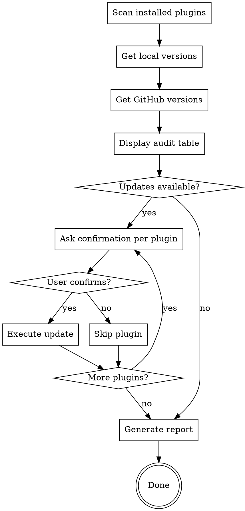

# Skills Updater

Audit all installed Claude Code plugins/skills, compare with latest GitHub versions, propose updates interactively, and generate a dated report.

## Prerequisites

- `gh` CLI installed and authenticated (`gh auth status`)
- Plugins installed via git in `~/.claude/plugins/marketplaces/`

## Process



## Step 1: Scan Installed Plugins

Scan `~/.claude/plugins/marketplaces/` to discover all installed plugin directories. List every subdirectory found -- do not assume a fixed list.

## Step 2: Get Local Versions

For each plugin, determine the installed version by checking (in order):
1. `.claude-plugin/plugin.json` -- look for `version` field
2. `package.json` -- look for `version` field
3. Git commit hash -- run `git -C <plugin-dir> rev-parse --short HEAD`
4. Cache directory names in `~/.claude/plugins/cache/` which encode versions in their path (e.g., `cache/<marketplace>/<plugin>/<version>/`)

For monorepos (like `claude-plugins-official`), sub-plugins share the same git commit. Report the commit hash as the version.

## Step 3: Get Latest GitHub Versions

For each plugin, find the GitHub repo and latest version:

1. **Find the repo URL**: Run `git -C <plugin-dir> remote -v` to get the origin URL
2. **Get the latest version** using `gh` CLI (try in order):
   - `gh release list --repo <owner/repo> --limit 1` -- for plugins with releases
   - `gh api 'repos/<owner>/<repo>/tags?per_page=1' --jq '.[0].name'` -- for plugins with tags only
   - `gh api 'repos/<owner>/<repo>/commits?per_page=1' --jq '.[0].sha[0:7]'` -- for rolling-release repos

**Important**: Run GitHub API calls in parallel when possible to speed up the audit.

## Step 4: Display Audit Table

Present results as a markdown table:

| Plugin | Installed | Latest | Repo | Status |
|--------|-----------|--------|------|--------|

Status values:
- **Up to date** -- installed version matches latest
- **Update available** (bold) -- newer version available, show `X.Y.Z -> A.B.C`
- **Rolling** -- no versioned releases, compare commit hashes
- **Unknown** -- could not determine latest version

## Step 5: Interactive Updates

For each plugin with **Update available** status, ask the user:

> `<plugin-name>`: update from `<old>` to `<new>`? (y/n)

If the user confirms:
- For **tagged/released plugins**: `git -C <plugin-dir> fetch --tags && git -C <plugin-dir> checkout <latest-tag>`
- For **rolling repos**: `git -C <plugin-dir> pull origin main` (or default branch)
- Verify the update succeeded by re-reading the version after update

If the user declines, skip and move to the next plugin.

## Step 6: Generate Report

Create the report directory if needed: `mkdir -p ~/.claude/reports/skills-audit/`

Write a dated report to `~/.claude/reports/skills-audit/YYYY-MM-DD.md`:

```markdown
# Skills Audit Report - YYYY-MM-DD

## Summary
- Plugins scanned: N
- Up to date: N
- Updated: N
- Skipped: N
- Errors: N

## Audit Results

| Plugin | Before | After | Repo | Action |
|--------|--------|-------|------|--------|
| ... | ... | ... | ... | Updated / Skipped / Already up to date |

## Details

### Updated
- **plugin-name**: old -> new (link to changelog/releases if available)

### Skipped
- **plugin-name**: old -> new (user declined)

### Errors
- **plugin-name**: error description (if any)
```

If a report already exists for the same date, append a timestamp suffix (e.g., `YYYY-MM-DD-2.md`).

Confirm to the user that the report has been written and show the path.

## Error Handling

- If `gh` CLI is not available, warn the user and suggest installing it
- If a git remote has no GitHub URL, skip it with a warning
- If a `git pull`/`checkout` fails, report the error, do NOT retry, and continue with the next plugin
- Never force-push or use destructive git operations on plugin directories
- Always quote URLs containing `?` in shell commands to avoid glob expansion

## Important Notes

- This skill is read-only by default -- it only modifies plugin directories when the user explicitly confirms an update
- Always show the full audit table BEFORE proposing any updates
